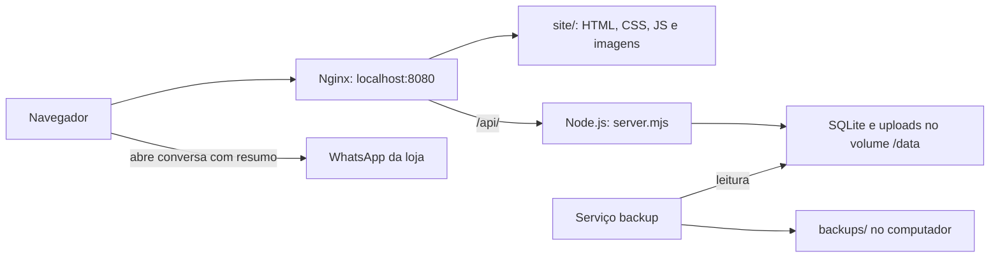

# Arquitetura e funcionamento

[Voltar ao índice](README.md)

## Serviços

O projeto usa HTML, CSS e JavaScript nativo no navegador, Nginx para servir arquivos e Node.js 24 com SQLite para a API. Não há etapa de compilação do frontend nem dependências npm para instalar na implementação atual.

O Compose mantém o nome `irmas-coqueiro` para continuar usando o volume existente. Somente o Nginx expõe porta ao computador, em `127.0.0.1:8080`. A API escuta em `3000` na rede interna do Compose.

## Mapa dos arquivos ativos

| Arquivo | Responsabilidade |
| --- | --- |
| [site/index.html](../site/index.html) | Estrutura da vitrine: cabeçalho, busca, rodapé e carregamento de scripts |
| [site/storefront.js](../site/storefront.js) | Renderização das páginas, navegação, filtros e interações |
| [site/shop-core.mjs](../site/shop-core.mjs) | Sanitização das listas, regras do carrinho e resumo do pedido |
| [site/brand.css](../site/brand.css) | Identidade visual, variáveis de cor e layout base |
| [site/marketplace.css](../site/marketplace.css) | Ajustes da vitrine: banner, busca, filtros, listas e histórico |
| [site/catalog.css](../site/catalog.css) | Visual específico do catálogo, abas com ícones e cartões de produtos |
| [site/contact.css](../site/contact.css) | Página Contato, atalhos de atendimento e dúvidas frequentes |
| [site/about.css](../site/about.css) | Página Sobre a loja, apresentação da marca e etapas de personalização |
| [site/purchases.css](../site/purchases.css) | Histórico vazio/preenchido, agrupamento visual e cartões de Minhas compras |
| [site/shopping.css](../site/shopping.css) | Seletor compartilhado e apresentação de Carrinho/Favoritos |
| [site/theme.js](../site/theme.js) | Tema claro/escuro e preferência salva |
| [site/config.js](../site/config.js) | Número comercial do WhatsApp e caminho relativo da API |
| [site/admin/admin.js](../site/admin/admin.js) | Login, edição direta e modo de gestão com rascunhos |
| [site/gestao/index.html](../site/gestao/index.html) | Tela de gestão que reutiliza o JavaScript administrativo |
| [backend/server.mjs](../backend/server.mjs) | HTTP, autenticação, validações e endpoints |
| [backend/database.mjs](../backend/database.mjs) | Esquema inicial, migrações existentes, seed e hash de senha |
| [backend/catalog-drafts.mjs](../backend/catalog-drafts.mjs) | Rascunhos, revisão, conflitos e publicação transacional |
| [backend/uploads.mjs](../backend/uploads.mjs) | Limpeza protegida das fotos sem uso |
| [backend/backup.mjs](../backend/backup.mjs) | Snapshot do banco e cópia das fotos referenciadas |
| [backend/backup-service.mjs](../backend/backup-service.mjs) | Agendamento e repetição do backup após falhas |
| [docker/nginx.conf](../docker/nginx.conf) | Proxy da API e rotas da vitrine |
| [compose.yaml](../compose.yaml) | Serviços, portas, ambiente e volumes |

## Páginas e navegação

As oito rotas da vitrine são `/`, `/produtos/`, `/produto/?id=…`, `/carrinho/`, `/favoritos/`, `/minhas-compras/`, `/contato/` e `/sobre/`.

O Nginx entrega `site/index.html` para as rotas virtuais. `render()` em `storefront.js` escolhe a página pela URL. Links internos são interceptados com a History API; carregar uma URL diretamente ou pressionar Voltar também precisa funcionar.

`/admin/` e `/gestao/` são páginas HTML próprias. O mesmo `admin.js` detecta o modo de gestão pela presença do botão `#publish-catalog`. Ao adicionar links para páginas independentes, confira também o interceptador de links da vitrine.

O link **ADM** no rodapé leva a `/gestao/`. O interceptador libera a navegação normal para `/admin/` e `/gestao/`, para carregar o HTML administrativo em vez de tentar renderizar essas telas como páginas da vitrine. O acesso às operações continua protegido pela sessão da API.

`/solicitar-acesso/` e `/autorizacoes/` também são páginas independentes, com `site/access.js` e `site/access.css`. A primeira pede acesso; a segunda exige a conta proprietária para decidir. O fluxo e o envio de e-mails estão em [Acessos administrativos](acessos-administrativos.md).

O catálogo usa os parâmetros `q`, `categoria`, `ate` e `ordem`. Eles representam busca, categoria, teto de preço e ordenação. Os filtros são refletidos na URL.

## Catálogo e publicação

1. A vitrine consulta `GET /api/products`, que retorna apenas produtos publicados e ativos.
2. O painel `/admin/` modifica a tabela de produtos diretamente.
3. A central `/gestao/` trabalha sobre uma cópia JSON independente do catálogo, armazenada no banco.
4. Cada gravação de rascunho atualiza `revision`. Operações com revisão antiga recebem 409.
5. `base_hash` permite detectar se o catálogo publicado mudou fora da central.
6. Publicar verifica os conflitos e as fotos, substitui o catálogo em uma transação e limpa o rascunho. Uma falha faz rollback.

O rascunho é compartilhado por todos os administradores desta instalação. Não há um rascunho individual por conta. A prévia inclui produtos ocultos; publicar não torna ativos os que continuam marcados como ocultos.

## Carrinho, favoritos e histórico

| Chave do localStorage | Conteúdo | Limite atual |
| --- | --- | --- |
| `dindinha-cart-v1` | IDs, quantidades, personalização e seleção | 30 linhas, 1–99 unidades, 500 caracteres por personalização |
| `dindinha-favorites-v1` | IDs únicos dos favoritos | 200 produtos |
| `dindinha-orders-v1` | Resumos de pedidos iniciados via WhatsApp | 50 registros |
| `ic-theme` | Escolha `light` ou `dark` | Uma preferência |

Esses dados pertencem ao navegador e à origem em que foram criados. Não são sincronizados entre dispositivos ou com o Lovable. O evento `storage` atualiza as listas entre abas da mesma origem.

Em Minhas compras, registros reais são ordenados do mais recente ao mais antigo e agrupados por mês, com dados de cada resumo e seus itens em uma área expansível. Sem registros, aparece uma apresentação de início, sem inserir pedidos fictícios. Os contadores representam resumos iniciados e unidades nesses resumos, não vendas confirmadas.

Ao finalizar, somente as linhas selecionadas vão para `/api/cart/quote`. O backend confere o catálogo e recalcula o preço em centavos. Depois, o navegador registra o resumo local e abre o WhatsApp. A aplicação não envia a mensagem nem confirma pagamento ou venda.

`renderVersion` e snapshots do carrinho impedem que uma resposta atrasada abra um pedido antigo depois de navegar ou mudar quantidades. No painel, os dados e o ID do produto são capturados antes do envio da foto.

## Estilos e referências antigas

Na vitrine, a ordem é `brand.css`, `marketplace.css`, `catalog.css`, `contact.css`, `about.css`, `purchases.css` e `shopping.css`. Os estilos específicos refinam suas páginas; `shopping.css` unifica o seletor das três listas e cuida de Carrinho/Favoritos. No catálogo, os botões de categoria filtram a mesma grade, preservando busca, faixa de preço e ordenação. Uma regra posterior pode sobrescrever a anterior; confira também os seletores `.dark` e as media queries.

O painel carrega `styles.css`, `local.css`, seus estilos administrativos e `brand.css`. Portanto, esses dois CSS antigos ainda têm uso. Já `site/app.js` e `site/catalog.js` não implementam a vitrine atual. As pastas de referência e os ZIPs antigos não são a fonte ativa do site.
